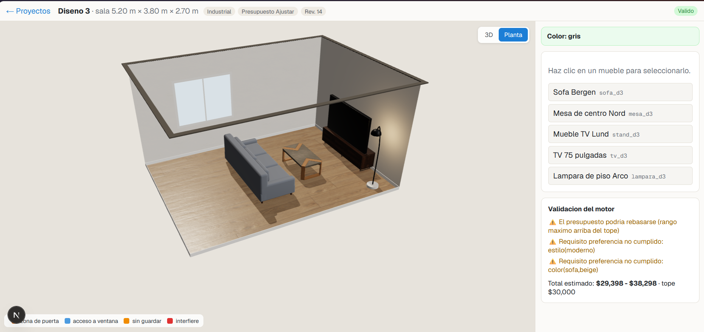
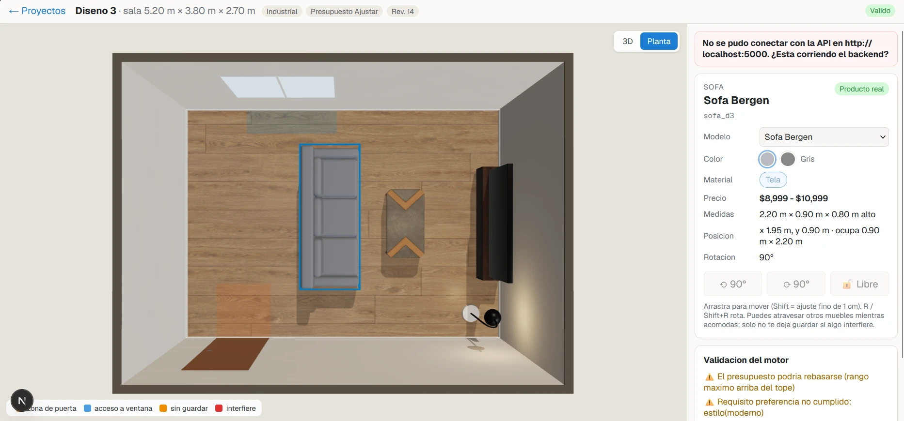
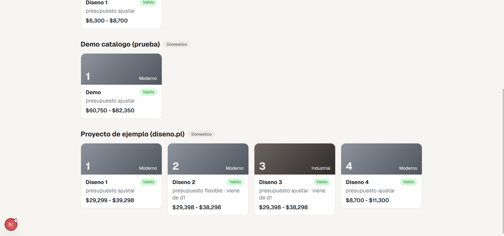

# Plataforma Inteligente de Diseno de Interiores Asistida por IA

Proyecto del **Equipo 1** - Instituto Tecnologico de Tijuana (Tijuana, Baja California, Mexico).

Plataforma web para disenar, planificar, visualizar y presupuestar espacios interiores reales con IA, un editor 3D,
catalogos de productos, renders en Blender y automatizacion con n8n. Las reglas de negocio estan en la base de
conocimiento en Prolog `diseno.pl`, que el motor de validacion reproduce y con la que se compara en las pruebas.

## Descripcion

La IA no entrega solo una imagen: el diseno es un **modelo estructurado, editable y persistente** (`DesignState`) conectado
con productos, presupuesto y versiones.

```
Espacio real -> analisis con IA -> requisitos -> propuestas -> modelo 3D
-> productos -> presupuesto -> modificaciones -> versiones -> exportacion
```

Principio clave: **IA propone -> el motor valida -> el sistema acepta o rechaza -> el frontend aplica.** La IA no es la
fuente de verdad.

## Alcance

**Espacios:** sala, recamara, cocina, oficina, comedor (solo interiores).

**Estilos:** moderno, minimalista, industrial, Japandi, clasico.

**Entradas del usuario:** fotografias (diseno de referencia), dimensiones, presupuesto, estilo, colores, muebles
existentes, restricciones y requisitos con prioridad.

**Salidas:** propuesta de diseno, distribucion 3D editable, render exacto en Blender (`.blend` + PNG), imagenes
hiperrealistas con IA, muebles recomendados, materiales, presupuesto por rubro, lista de compras, lista de materiales,
plano 2D (SVG/PDF), reporte PDF, Excel/CSV y modelo 3D (GLB).

**Tipos de proyecto:** comercial (oficina) y domestico.

## Que hace la plataforma

| Funcion | Donde |
|---|---|
| Crear proyecto, cuarto (medidas, puertas, ventanas, acabados) y requisitos desde cero | Inicio -> "Nuevo" |
| Editor 3D: mover (clic izq.), girar libre (clic der.), bloquear, cambiar modelo/color/material | Pestana Diseno |
| Vistas 3D, Foto (altura de los ojos) y Planta | Botones arriba del visor |
| Versiones tipo hojas de Excel, duplicar, comparar, historial y revertir | Barra de versiones / Historial |
| Presupuesto por rubro con rangos, modos minimizar/ajustar/flexible y ahorros sugeridos | Pestana Presupuesto |
| Requisitos con prioridad y decision cuando dos requisitos chocan | Pestana Requisitos |
| **Disenar con IA**: la IA arma un diseno propio del estilo elegido (version nueva) | Pestana IA |
| **Copiar un diseno de internet**: subir una foto y la IA lo copia en tu cuarto | Pestana IA |
| **Chat**: "hazlo mas minimalista", "cambia el sofa por uno mas chico" (aplicas solo lo valido) | Pestana IA |
| **Render realista con IA** de la vista actual y **4 vistas realistas** (burbujas arriba a la derecha) | Pestana IA / visor |
| **Render exacto en Blender** (Cycles) y archivo `.blend` | Pestana IA |
| Listas de compras y materiales (10% de desperdicio), PDF, Excel, CSV, plano 2D, GLB, `.blend` | Pestana Exportar |

Todo lo que propone la IA pasa por el motor de validacion: lo que no cabe, choca, tapa puertas o ventanas, rebasa el
presupuesto o rompe un requisito obligatorio se rechaza y se le explica al usuario.

## Arquitectura

```
                 +-------------------+        +---------------------------+
  Navegador ---> |  Frontend         | -----> |  API .NET (puerto 5000)   | ---> PostgreSQL
                 |  Next.js + Three  |  REST  |  datos, motor de reglas,  |
                 |  (puerto 3000)    |  + SSE |  versiones, presupuesto   |
                 +-------------------+        +---------------------------+
                                                 |  crea trabajo  ^  resultado (validado por el motor)
                                                 v                |
                                          +----------------+      |
                                          |  n8n (5678)    | -----+   solo orquesta
                                          +----------------+
                                                 |
                                                 v
                                     +-------------------------------+
                                     |  Servicio de IA en Python     |
                                     |  (FastAPI, puerto 8100)       | ---> OpenAI (texto e imagenes)
                                     |  prompts (/ai-rules), render, | ---> Blender (build_scene.py)
                                     |  Blender, PDF/Excel/plano     |
                                     +-------------------------------+
```

| Componente | Tecnologia | Funcion |
|---|---|---|
| Frontend | Next.js 16, React 19, Three.js + React Three Fiber, postprocesado (SSAO) | Editor y visor 3D, paneles |
| API y motor | .NET 10 (ASP.NET Core), EF Core + PostgreSQL 17 | Datos, motor de validacion (= `diseno.pl`), versiones, presupuesto, listas |
| Servicio de IA | **Python** 3.14 + FastAPI | **Todo el procesamiento de IA**: prompts con `/ai-rules`, OpenAI, imagenes, Blender, exportaciones |
| Orquestador | n8n 2.x | Recibe trabajos de la API, llama al servicio de IA y regresa el resultado (no hace tiempo real) |
| 3D exacto | Blender 4.3 (Cycles) | `blender/build_scene.py`: DesignState -> `.blend` + render |
| Verificador | SWI-Prolog | Las pruebas comparan el motor contra `diseno.pl` |

Decisiones y su porque: [`docs/decisiones.md`](docs/decisiones.md).

## Estructura del repositorio

```
.
|-- diseno.pl                 base de conocimiento (especificacion de las reglas)
|-- ai-rules/                 reglas para la IA (global, seguridad, disenador, imagenes, Blender...)
|-- ai-service/               servicio de IA en Python (FastAPI) + pruebas (pytest)
|-- backend/                  API .NET, motor de validacion, BD (EF Core), puente a Prolog + pruebas (xUnit)
|-- blender/                  build_scene.py (DesignState -> Blender) y render_design.ps1
|-- frontend/                 Next.js: editor 3D, paneles, assets CC0 (public/assets)
|-- n8n/                      flujos exportados (workflows/*.json), generador y scripts de arranque/publicacion
|-- schemas/                  JSON Schema de DesignState, habitacion y catalogo + ejemplos d1-d4
|-- scripts/                  start-all.ps1 (arrancar todo) y test-all.ps1 (todas las pruebas)
|-- prolog/                   puente para consultar diseno.pl desde .NET
|-- docs/                     decisiones, esquema SQL, capturas, PDF del proyecto
`-- storage/                  (fuera de git) fotos subidas, renders, archivos de Blender
```

## Requisitos (Windows)

| Programa | Version probada | Para que |
|---|---|---|
| .NET SDK | 10 | API y motor |
| Node.js | 26 | Frontend y n8n |
| Python | 3.14 | Servicio de IA |
| PostgreSQL | 17 | Base de datos (servicio de Windows) |
| n8n | 2.46 (`npm install -g n8n`) | Orquestador |
| Blender | 4.3 | Render exacto y `.blend` (opcional) |
| SWI-Prolog | 10.0 | Comparar el motor con `diseno.pl` en las pruebas (opcional) |
| Cuenta de OpenAI | - | API key para la IA (texto e imagenes) |

## Instalacion (una sola vez)

1. Copia `.env.example` como `.env` y llena:
   - `POSTGRES_*` (tu PostgreSQL local).
   - `OPENAI_API_KEY` (tu key; solo vive en `.env`, que esta en `.gitignore`).
   - `N8N_CALLBACK_SECRET` (cualquier texto largo y aleatorio).
   - Opcionales: `BLENDER_PATH`, `SWIPL_PATH`, `OPENAI_IMAGE_QUALITY` (`low`/`medium`/`high`).
   > El `.env` tiene prioridad: si en Windows tienes otra variable `OPENAI_API_KEY`, se usa la del `.env`.
2. Frontend:
   ```powershell
   npm --prefix frontend install
   npm --prefix frontend run assets     # baja modelos y texturas CC0 de Poly Haven
   ```
3. Servicio de IA (Python):
   ```powershell
   python -m venv ai-service\.venv
   ai-service\.venv\Scripts\python.exe -m pip install -r ai-service\requirements.txt
   ```
4. n8n: arrancalo una vez (`powershell -ExecutionPolicy Bypass -File n8n\start-n8n.ps1`), crea tu cuenta en
   http://localhost:5678, detenlo (Ctrl+C) y publica los flujos:
   ```powershell
   powershell -ExecutionPolicy Bypass -File n8n\publish-workflows.ps1
   ```
5. La base de datos se crea sola: la API aplica las migraciones y carga los ejemplos `d1`-`d4` al arrancar.

## Como ejecutar

```powershell
powershell -ExecutionPolicy Bypass -File scripts\start-all.ps1          # desarrollo
powershell -ExecutionPolicy Bypass -File scripts\start-all.ps1 -Prod    # web compilada (mas rapida)
```

Abre http://localhost:3000. Otros: API/Swagger http://localhost:5000/swagger, servicio de IA
http://127.0.0.1:8100/health, n8n http://localhost:5678.

Render de Blender por comando (sin la pagina): `powershell -ExecutionPolicy Bypass -File blender\render_design.ps1 -DesignId d1 -Views all`.

## Pruebas

```powershell
powershell -ExecutionPolicy Bypass -File scripts\test-all.ps1
```

Corre (con la API detenida): pruebas del motor y de la API en .NET (incluye la comparacion contra `diseno.pl` si hay
SWI-Prolog y una BD de prueba `iaproyect_test` si hay PostgreSQL), pruebas del servicio de IA en Python (OpenAI y Blender
simulados, no gasta credito) y tipos, lint y compilacion del frontend.

## Rol de Prolog en el proyecto

`diseno.pl` representa en Prolog: espacios, estilos, entradas y salidas; elementos estructurales (protegidos) vs
modificables; prioridades de requisitos; catalogo, proveedores y materiales; habitaciones con puertas y ventanas;
objetos con posicion y rotacion; disenos como versiones; presupuesto por rubro con rangos; **conflictos** y
**advertencias**; validacion de propuestas de la IA (`veredicto/3`); similares y reemplazos; lista de compras y de
materiales (con factor de desperdicio); explicacion de decisiones; reglas de las IA y flujos de n8n.

```prolog
?- consult('diseno.pl').
?- pruebas.
?- conflictos(d2, L).
?- veredicto(d1, reemplazar(sofa_d1, sofa_001), V).
?- lista_materiales(d1, Items).
```

| Predicado | Que hace |
|---|---|
| `producto/8` | Catalogo: id, nombre, categoria, dimensiones, materiales, colores, estilos, precio |
| `habitacion/5`, `puerta/5`, `ventana/6` | Geometria del espacio |
| `diseno/3`, `objeto/3`, `coloca/5`, `config/4` | Version de diseno, objetos y su posicion/configuracion |
| `requisito/3` | Requisitos del usuario por habitacion y prioridad |
| `presupuesto_total/3`, `presupuesto_rubro/4` | Presupuesto dinamico (rangos) |
| `conflicto/2`, `diseno_valido/1`, `advertencia/2` | Conflictos que invalidan un diseno y avisos que no bloquean |
| `validar_propuesta/3`, `veredicto/3` | Validacion de acciones propuestas por la IA |
| `similar/2`, `buscar_similares/2`, `alternativas/3` | Productos similares y reemplazos |
| `comparar_versiones/3` | Diferencias entre disenos |
| `lista_compras/2`, `lista_materiales/2` | Salidas de compra |
| `interpretar/2` | Palabras clave a intenciones |

## Convenciones

- Medidas en **cm**, precios en **pesos MXN**.
- Coordenadas: esquina (0,0) = suroeste; `x` a lo largo (este), `y` a lo ancho (norte). Paredes: sur, norte, oeste, este.
- Rotacion en grados 0-359, antihoraria; 0 = el frente mira al sur.
- Cada objeto tiene un `instanceId` unico que es el mismo en el DesignState, en Three.js, en el GLB y en Blender.
- Marcadores: `[DOC]` viene del documento, `[EJEMPLO]` dato inventado para pruebas, `[SUPUESTO]` decision a confirmar.

## Avance del prototipo (capturas)

**Editor 3D** - muebles con medidas reales, sombras y luz natural; a la derecha, objetos y validacion del motor.



**Vista de planta** - sofa seleccionado con su panel de configuracion; zonas de la puerta (naranja) y de la ventana (azul).



**Inicio** - proyectos y sus versiones, con estilo, modo de presupuesto, rango de precio y si son validas.



## Pendientes conocidos

- **Datos reales:** el catalogo, los precios y los proveedores son `[EJEMPLO]`; falta conectar proveedores reales con
  adaptadores.
- **Parametros `[SUPUESTO]`** por confirmar con el equipo: ocupacion maxima (60%), acceso a ventanas (40 cm), margen
  flexible (10%), alto de puerta (2.10 m). El desperdicio de materiales (10%) ya lo confirmo el usuario.
- **Inmueble comercial:** falta definir su geometria y caracteristicas (propuesta en `caracteristica_inmueble/2`).
- **Mas modelos 3D:** 18 de 50 productos tienen modelo GLB; el resto se arma por piezas. Falta una ronda de modelos y
  decoracion (cojines, jarrones, libros, plafones) para que el 3D y Blender luzcan como un render profesional.
- **Doble altura, escaleras y cambios de estructura sugeridos por la IA** (con confirmacion del usuario): no implementado.
- **Blender en CPU:** sin tarjeta NVIDIA cada vista de calidad alta tarda ~3-4 min.
- **Imagenes con IA:** son ayuda visual con su leyenda; a veces cambian detalles chicos (no son exactas).
- **n8n:** publicar flujos con n8n corriendo no siempre se aplica; usar `n8n/publish-workflows.ps1` con n8n detenido.
- **Seguridad para produccion:** el servicio de IA solo escucha en 127.0.0.1 y la API no tiene usuarios ni login; antes de
  publicarlo en internet hace falta autenticacion, HTTPS y object storage real (hoy `storage/` local).

## Principios del proyecto

1. La IA ayuda, pero el usuario decide.
2. El diseno debe ser editable.
3. El modelo estructurado es la fuente de verdad.
4. Las imagenes generadas son representaciones, no la fuente geometrica.
5. Las dimensiones reales deben respetarse.
6. Las restricciones obligatorias deben mantenerse.
7. El presupuesto debe ser visible y dinamico.
8. Cada objeto debe poder identificarse.
9. Los productos reales se diferencian de los elementos conceptuales.
10. Las versiones deben ser independientes.
11. Los cambios deben poder revertirse.
12. La IA debe validar sus propuestas.
13. Los elementos estructurales deben estar protegidos.
14. El sistema debe ser extensible a nuevos proveedores.
15. n8n es orquestador, no sustituto del backend ni del motor 3D.
